<div align="center">

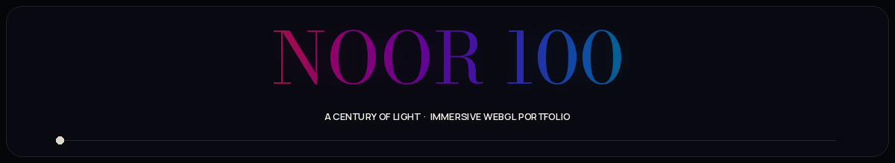


### An immersive, scroll-driven WebGL portfolio template — a century of one artist's light, walked through on water.

**No build step. No dependencies to install. Open, scroll, and it runs.**

</div>


**NOOR 100** is a complete, self-contained immersive portfolio website. It tells the fictional story of **Mira Noor (1926—2026)**, a painter of light from Lahore, across six rooms of a gallery that floats on black water — from a moonlit garden door to a final oval _Afterimage_ room, ending in a browsable archive of **1,247 works**.

Every asset in this repository is original and included locally: the paintings, the 120-frame prologue sequence, the catalogue sprite sheets, the 3D architecture, the fonts, and the ambient sound design. Nothing is fetched from a CDN at runtime, so the site works identically offline, locally, and on GitHub Pages.

> This is a **template**: a fully working design system you can re-skin with your own name, works, and story in under an hour (see [07 — Customisation](#customisation)).

<br>

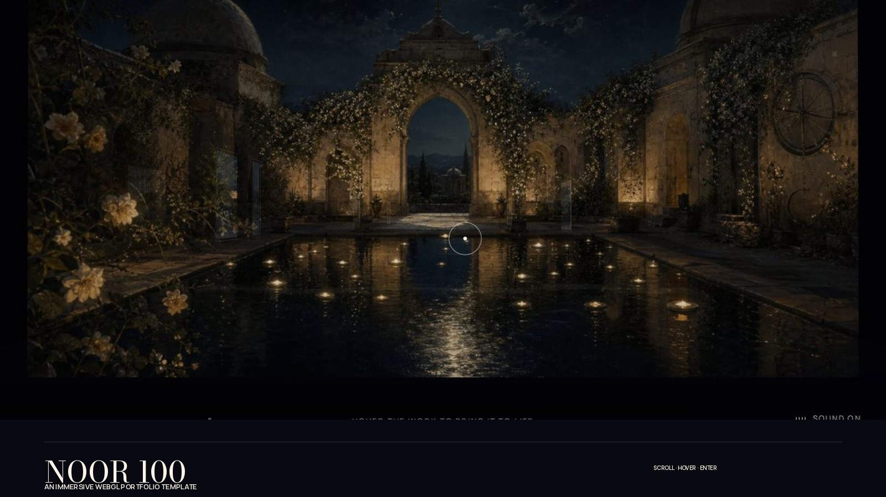


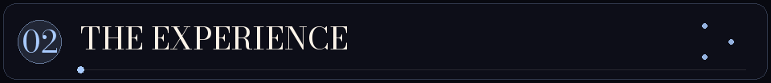

A single continuous scroll drives the entire visit — about **2000vh** of camera dolly through the gallery, bookended by cinematic chapters.

| #   | Chapter                 | What happens                                                                                    |
| --- | ----------------------- | ----------------------------------------------------------------------------------------------- |
| 1   | **Cataract preloader**  | Rolling 0—100 counter while the scene streams in, with a live `n / 11` asset tally              |
| 2   | **The garden door**     | Moonlit threshold. Hold-to-enter cursor, circular _Enter with sound_ control                    |
| 3   | **Prologue interlude**  | Three chapters, 120 hand-graded frames (60 landscape / 60 portrait), skippable                  |
| 4   | **The long gallery**    | Scroll-dolly camera on water; hover a painting to light it, click to approach and read its card |
| 5   | **The corridor title**  | A giant dissolve-in headline — _ONE LIGHT, EVERY HOUR._ — mid-route                             |
| 6   | **The Afterimage room** | An oval, panoramic final chamber with the closing quote                                         |
| 7   | **The catalogue**       | All 1,247 works in a sticky 3D wall with a draggable year timeline and zoom views               |
| 8   | **Archive records**     | Every catalogue row deep-links to its own `archive.html` record page                            |

**Controls** — `Scroll` travel · `Hover` highlight · `Click` approach · `Esc` step back · `Enter` with sound · Sound toggle top-right · Timeline drag in the catalogue · Full keyboard navigation (`Home` / `End` / arrows) · Respects `prefers-reduced-motion`.

<br>

<table>
<tr>
<td width="50%">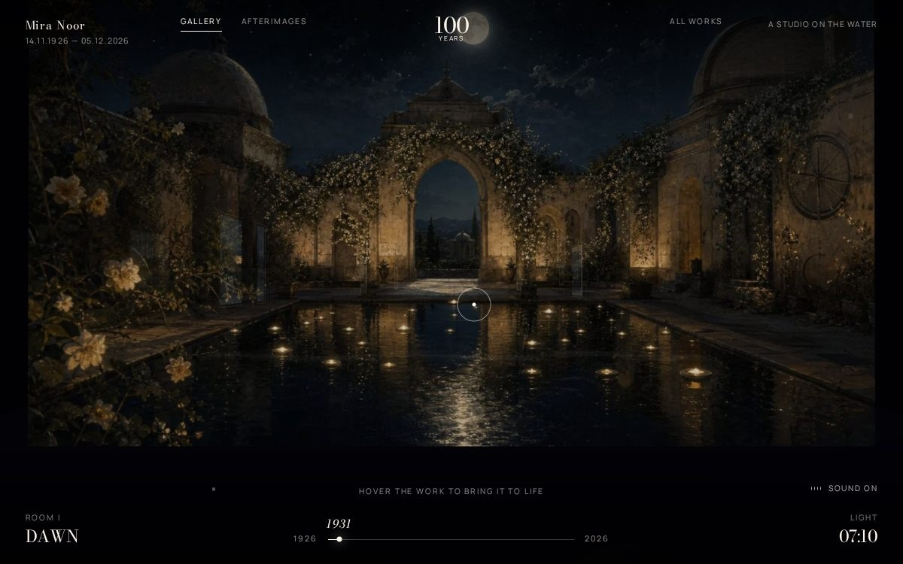</td>
<td width="50%">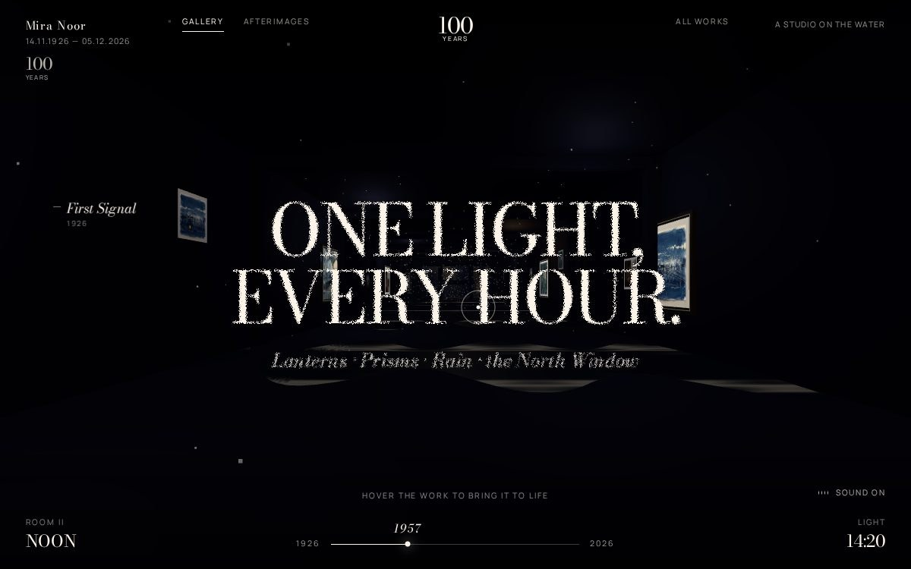</td>
</tr>
<tr>
<td>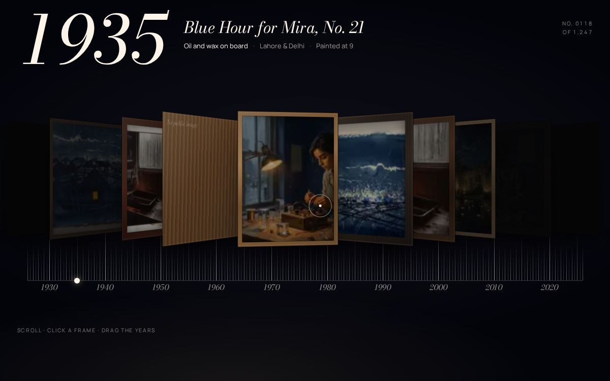</td>
<td>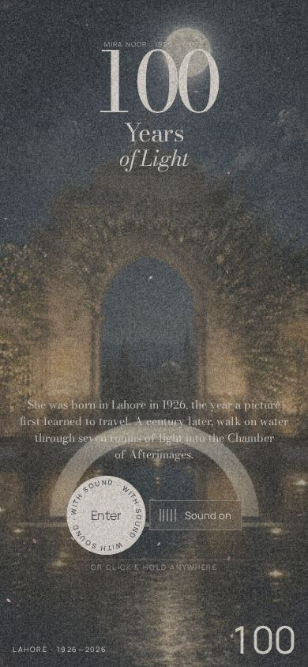</td>
</tr>
</table>


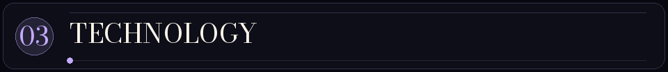

The same class of technology as the award-winning immersive tributes that inspired it — rebuilt from scratch, with zero runtime services.

| Layer        | Choice                                          | Why                                                               |
| ------------ | ----------------------------------------------- | ----------------------------------------------------------------- |
| Renderer     | **Three.js 0.180.0** (vendored in `/vendor`)    | WebGL gallery, water shader, dust particles, panorama room        |
| Architecture | **procedural glTF 2.0** (`assets/gallery.gltf`) | Colonnade geometry generated offline, embedded buffers, tiny file |
| Logic        | **Vanilla ES modules** (`/js`)                  | No framework, no bundler — what you see is what ships             |
| Sound        | **WebAudio API** (`js/audio.js`)                | Procedural ambient bed + interaction ticks, no audio files        |
| Imagery      | **Local WebP/JPG** (`assets/images`)            | 31 original artworks, parallax layers, noise, OG image            |
| Catalogue    | **8×8 sprite sheets** (`assets/sheets`)         | 1,247 thumbnails in just 20 GPU-friendly files                    |
| Fonts        | **Bodoni Moda + Manrope** (local TTF, OFL)      | Editorial display serif + clean UI sans, self-hosted              |
| Deployment   | **Static files + `.nojekyll`**                  | GitHub Pages serves it as-is; no Actions, no build                |

**Runtime footprint:** ~18 MB of assets, progressively loaded behind the preloader. Works down to 360 px wide, with a dedicated portrait prologue set, coarse-pointer cursor fallback, and a non-WebGL image fallback.


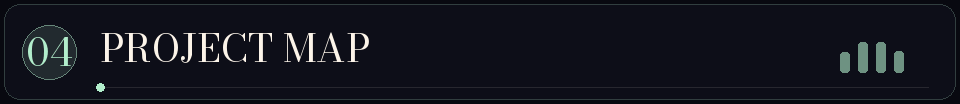

```
noor-100/
├── index.html              # Entry — shell, metadata, JSON-LD, import map
├── archive.html            # Dynamic record page (?work=N-0001 … N-1247)
├── site.webmanifest        # PWA manifest (icons, theme colour)
├── robots.txt  .nojekyll   # Crawlers + disable Jekyll on Pages
├── LICENSE  .gitignore     # MIT + local-only file exclusions
│
├── css/                    # base · ui · catalogue · responsive (4 files)
├── js/                     # main · scene · ui · interlude · catalogue
│                           # cursor · audio · data · works-data (9 modules)
├── vendor/                 # three.module.js · three.core.js · GLTFLoader
│
├── assets/
│   ├── gallery.gltf        # Procedural 3D colonnade
│   ├── images/             # 31 artworks, layers, favicon, OG (31 files)
│   ├── sheets/             # 20 catalogue sprite sheets (8×8 tiles)
│   └── fonts/              # Bodoni Moda ×2 · Manrope ×2 · OFL licences
│
├── prologue/
│   ├── d/                  # 60 landscape frames (chapters 1–3)
│   └── v/                  # 60 portrait frames
│
└── docs/assets/            # README media (GIFs, previews, badges)
```

**227 files total · ~18 MB** — everything included, nothing to install.


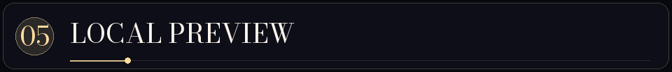

ES modules require an HTTP origin — opening `index.html` directly from disk (`file://`) will not work. Any static server does the job:

```bash
# Option 1 — Python (preinstalled almost everywhere)
cd noor-100
python3 -m http.server 8000
# → open http://localhost:8000

# Option 2 — Node
npx serve noor-100        # or: npx http-server noor-100

# Option 3 — VS Code
# Install "Live Server" → right-click index.html → "Open with Live Server"
```

Then scroll. First load takes a few seconds while the preloader streams the scene — that _is_ the experience working.


<a id="customisation"></a>
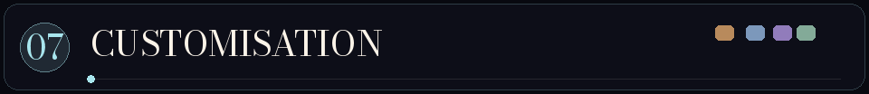

Everything content-related lives in two friendly files — no WebGL knowledge needed:

| You want to change…                                  | Edit…                                                             |
| ---------------------------------------------------- | ----------------------------------------------------------------- |
| Artist name, dates, quote, room names, footer, links | `js/data.js` (`SITE`, `ROOMS`, `LINKS`)                           |
| The seven principal works (titles, years, stories)   | `js/data.js` (`WORKS`) + images in `assets/images/work-0X.webp`   |
| The 1,247 catalogue rows                             | `js/works-data.js`                                                |
| Prologue chapters and captions                       | `js/data.js` (`PROLOGUE`) + frames in `prologue/d` & `prologue/v` |
| Colour theme, typography, spacing                    | Tokens at the top of `css/base.css`                               |
| Scene mood (fog, lights, water, camera path)         | Clearly-commented blocks in `js/scene.js`                         |

Images are plain files — replace like-for-like (same filename, similar dimensions) and the site updates with no code changes.


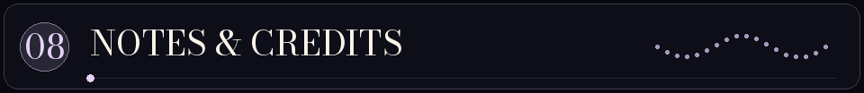

- **Mira Noor is fictional.** Every artwork, archive record, and biographical line was created for this template. Replace them with your own story before publishing as a real portfolio.
- **Code** is released under the [MIT License](LICENSE).
- **Fonts** — Bodoni Moda and Manrope under the SIL Open Font License (copies in `assets/fonts/`).
- **Three.js** © its authors, MIT — vendored unmodified in `vendor/`.
- Design language pays homage to the craft of immersive WebGL exhibitions; all implementation and assets here are original.

<div align="center">


**NOOR 100** — _a studio on the water._

Made to be remade. ☾

</div>
